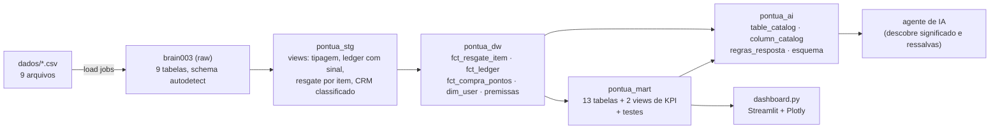

# Pontua+ · Pontos no Pix — Case Analytics Engineer (Brain003)


-2ca58d)
-8a8f98)

> **Documento principal da solução.** O [`README.md`](README.md) original do repositório (enunciado do case) foi preservado sem alterações.
> Todos os dados são fictícios (gerados para o processo seletivo).
> Extração dos dados: **01/10/2026**. Cobertura analisada: **out/2025 a set/2026**.

| Entrega | Onde |
|---|---|
| Pipeline (ingestão → modelagem → testes) | [`run_all.sh`](run_all.sh), [`ingestao_bigquery.py`](ingestao_bigquery.py), [`modelagem_bigquery.py`](modelagem_bigquery.py), [`testes_bigquery.py`](testes_bigquery.py) |
| Modelagem SQL (todas as camadas e testes) | [`sql/pontua_modelagem_v5.sql`](sql/pontua_modelagem_v5.sql) |
| Dashboard | [`dashboard.py`](dashboard.py) |
| Registro de uso de IA | [`AI_LOG.md`](AI_LOG.md) e a [seção 7](#7-registro-de-uso-de-inteligência-artificial) |
| Tempo de trabalho | _a preencher pela candidata (o enunciado pede o tempo gasto)_ |

---

## 1. Guia rápido de reprodução

**Pré-requisitos:** Python 3.10+, um projeto GCP com BigQuery e uma service account com a chave JSON.
Papéis usados na validação: *Administrador do BigQuery* e *Editor de dados do BigQuery*. O mínimo provável é *Editor de dados* + *Usuário de job* (não testado isoladamente).

```bash
git clone <repositório> && cd case-ae-mariana
cp .env.example .env          # edite GCP_PROJECT_ID e GOOGLE_APPLICATION_CREDENTIALS (caminho da chave JSON)
./run_all.sh                  # venv → ingestão → modelagem SQL → testes → dashboard (http://localhost:8501)
```

`./run_all.sh --sem-dashboard` executa tudo exceto o último passo (útil em CI).

| # | Etapa | Comando executado pelo `run_all.sh` | Tempo medido |
|---|---|---|---|
| 1 | venv + dependências | `python3 -m venv .venv` + `pip install -r requirements.txt` | — |
| 2 | Ingestão dos 9 CSVs de `dados/` | `ingestao_bigquery.py` (load jobs, `autodetect`, `WRITE_TRUNCATE`) | 67 s |
| 3 | Modelagem (stg → dw → mart → ai) | `modelagem_bigquery.py` aplica `sql/pontua_modelagem_v5.sql` | 49 s |
| 4 | Testes de integridade | `testes_bigquery.py` lê `pontua_mart.testes` e falha em ERRO | 3 s |
| 5 | Dashboard | `streamlit run dashboard.py` | — |

O `.env` precisa apenas de:

| Variável | Exemplo | Observação |
|---|---|---|
| `GCP_PROJECT_ID` | `stoked-outlook-303718` | |
| `GOOGLE_APPLICATION_CREDENTIALS` | `./stoked-outlook-303718-….json` | a chave está no `.gitignore`; nunca versionar |
| `BIGQUERY_DATASET_ID` | `brain003` | dataset **bruto**; aceita `projeto.dataset` |
| `CSV_FOLDER_PATH` | `./dados` | |

> [!NOTE]
> **Região.** O script SQL cria os datasets `pontua_*` com `location='US'`. O `modelagem_bigquery.py` troca, em memória, pela região do dataset bruto, porque o BigQuery não permite *join* entre regiões (aqui: `us-central1`). O arquivo `.sql` não é alterado.

> [!WARNING]
> **Projeto sandbox.** Em projetos BigQuery sem faturamento, as tabelas expiram em 60 dias (o dashboard pararia de funcionar). Isso faz falhar o teste `tabelas_sem_expiracao` (ERRO). O `testes_bigquery.py` o marca como `IGNORADO` por padrão (`TESTES_IGNORADOS`); para eliminar a causa, ative o faturamento e remova a expiração padrão dos datasets.

**Execução validada de ponta a ponta nesta entrega:** 9/9 CSVs carregados com contagem CSV = BigQuery; modelagem concluída; 31 testes, todos os 20 de severidade ERRO passando (exceto o de expiração, tolerado como acima) e 5 ALERTAS de dados.

---

## 2. Entendimento dos dados e arquitetura de modelagem

### 2.1 Fluxo entre camadas



| Camada | Conteúdo | Regra de negócio? |
|---|---|---|
| **Raw** (`brain003`) | Os 9 CSVs como vieram (contagem conferida arquivo a arquivo na ingestão) | Não |
| **`pontua_stg`** | 4 views: `orders` (recupera `user_id` via `carts`), `ledger` (sinal pela direção da operação), `resgate_por_item` (RESERVA e CANCELADO_RESERVA se anulam; só RESGATE conta), `crm` (classifica evento e canal) | Só limpeza |
| **`pontua_dw`** | Fatos e dimensão + `premissas` (cada parâmetro com status DADO / DECLARADO / PROXY / PENDENTE) | Sim, centralizada |
| **`pontua_mart`** | Tabelas de dashboard, grão declarado no `description` de cada uma | Agregações |
| **`pontua_ai`** | Catálogo de tabelas e colunas, regras de resposta (recusar, ressalvar, conferir) | Semântica |

### 2.2 Grão, chaves e decisões de modelagem

| Modelo | Grão (PK) | Chaves estrangeiras | Observações |
|---|---|---|---|
| `fct_resgate_item` | `order_item_id` (19.283 linhas) | `order_id`, `user_id`, `account_id` | Exclui `COMPRA_PONTOS`. Categoria: `PIX` por `supplier_responsible = 'Pix Pontua+'`, senão `AEREAS`/`VAREJO` por `category_macro`. **Volume resgatado = `pts_liquidos` com `is_confirmado`.** |
| `fct_compra_pontos` | `order_item_id` (520) | `order_id`, `user_id` | Compras de pontos ficam fora do mix e das metas |
| `fct_ledger` | `movement_id` (146.739, igual ao bruto) | `user_id`, `account_id`, `operation_code` | `pontos_assinados` (+crédito/−débito), `is_migracao` (códigos 100/103) |
| `dim_user` | `user_id` (12.000) | — | Cartão mais recente, saldo na véspera do Pix, faixa de saldo, 1º resgate e 1º Pix |
| `premissas` | `chave` | — | Fonte única de parâmetros; `cfg` é a view que as pivota |

**Descobertas sobre os dados (confirmadas por teste ou consulta):**

- `orders.user_id` vem **nulo** no extrato; é recuperado por `cart_id → carts` (teste `raw_carts_um_usuario_por_cart` garante 1 usuário por carrinho; `itens_sem_user = 0` depois).
- Um item de pedido pode ser pago com pontos de **2 contas**: a soma das linhas RESGATE em `redeemed_points` bate com `paid_points` nos 17.823 itens com resgate (`resgate_soma_bate_com_paid_points`).
- Transferências para parceiros (`TRANSFERENCIA`) são **varejo** (parceiros do grupo); `OUTROS` está vazio.
- **Datas:** `created_at` vem com offset `-03:00` e é carregado como `TIMESTAMP`; todas as datas de negócio (`data_resgate`, `data_mov`, `mes`) usam `America/Sao_Paulo`. A data de extração (`premissas.data_extracao`) substitui `CURRENT_DATE`, para o resultado não mudar com o tempo.
- `user_id` e `cart_id` são padronizados como `STRING` nas views (decisão da v5), para que os *joins* entre fontes não dependam do tipo inferido em cada CSV.
- Fatos **sem `PARTITION BY`**: o volume é pequeno e a partição aumentava o risco de expiração; usam `CLUSTER BY`.
- `kpi_mensal` mostra jan/2026 como outlier (96,8% aéreas, 88 M de pontos). Foi mantido (é o dado) e a análise de baseline pré-Pix pode excluí-lo.

### 2.3 Estrutura de dados para dashboard e agente (justificativa)

- **Mesmas tabelas servem aos dois consumidores:** o `pontua_mart` tem uma tabela por pergunta de negócio (grão pequeno, métricas prontas), de modo que o dashboard consulta só agregados e o agente escreve SQL simples.
- **Como o agente descobre o significado dos campos:** (1) `pontua_ai.table_catalog` diz qual tabela usar e quando; (2) `pontua_ai.esquema` (view) junta o tipo real do `INFORMATION_SCHEMA` com a descrição de `column_catalog`; (3) `premissas.status` indica se um valor é confiável; (4) `regras_resposta` define quando **recusar** (dados individuais, previsão como fato, métrica fora do catálogo), **ressalvar** (breakage, CRM, custo) e **conferir** (`pontua_mart.testes` antes de responder).
- **Nomes:** sufixos de unidade e definição no nome (`pct_*` em 0–100, `pts_*` em pontos, `*_r_por_ponto`), `origem_custo` explícito (`DADO_TAXA_EFETIVA` / `PREMISSA` / `PROXY_VALOR_ENTREGUE`).
- **Documentação como dado:** o teste `tabelas_mart_catalogadas` falha se uma tabela do mart não estiver no catálogo.

---

## 3. Respostas executivas (números lidos do BigQuery)

### 3.1 O que aconteceu com os resgates depois do Pix

O Pix passou de 4,9% do mix em mai/26 (lançamento em 27/05) para ~**28–30%** de jun a set, com ~700 transações e ~600 usuários por mês e R$ 170–178 mil entregues/mês.

| Mês | Pontos resgatados | Aéreas | Varejo | Pix | Gap aéreas (p.p.) | Gap varejo (p.p.) | Pontos faltantes p/ varejo 20% | Folga do Pix (p.p.) |
|---|---:|---:|---:|---:|---:|---:|---:|---:|
| 2026-05 | 21,5 M | 74,9% | 20,2% | 4,9% | +24,9 | +0,2 | 0 | +25,1 |
| 2026-06 | 30,3 M | 56,4% | 13,2% | 30,4% | +6,4 | **−6,8** | 2.054.772 | −0,4 |
| 2026-07 | 30,5 M | 58,0% | 12,6% | 29,4% | +8,0 | **−7,4** | 2.246.422 | +0,6 |
| 2026-08 | 31,3 M | 58,0% | 12,1% | 29,9% | +8,0 | **−7,9** | 2.473.764 | +0,1 |
| 2026-09 | 33,4 M | **59,1%** | **12,9%** | 28,1% | +9,1 | **−7,1** | **2.390.761** | +1,9 |

1. **Meta de aéreas (≥ 50%): atingida** em todos os meses; em set/26 foi **59,1%** (+9,1 p.p.).
2. **Meta de varejo (≥ 20%): não atingida de jun a set.** Em set/26: **12,9%**, gap de **−7,15 p.p.**, ou **2.390.761 pontos** abaixo da meta. Antes do Pix a meta foi cumprida em 5 dos 7 meses (falhas em jan/26, por pico de aéreas, e abr/26, com 19,2%).
3. **O Pix é, em grande parte, volume novo, não troca de categoria.** Em pontos absolutos, aéreas foi de 15,2 M (abr) para 19,8 M (set) e varejo ficou em 3,6–4,3 M; o Pix somou ~9,2 M por mês. A queda do varejo no mix vem mais da **diluição pelo denominador maior** do que de perda de volume.
4. **O Pix não é a única causa do descumprimento do varejo.** Considerando só aéreas + varejo (como se o Pix não existisse), o varejo seria 19,0% (jun), 17,9% (jul), 17,3% (ago) e 17,9% (set): abaixo de 20% desde julho.
5. **Canibalização medida (antes/depois do 1º Pix, 60 dias, por adotante):** varejo **−6,0%** (611 adotantes) e aéreas **+0,4%** (784). É associação sem grupo de comparação, não causalidade.
6. **Teto do Pix:** com aéreas e varejo exatamente nos mínimos, o Pix caberia em 30% do mix. A folga real é de apenas 0,1 a 1,9 p.p. (negativa em jun).

### 3.2 Avaliação das três afirmações

| Afirmação | Veredito | Evidência |
|---|---|---|
| **CRM:** "a comunicação de lançamento explica o sucesso do Pix" | **Não demonstrável** | `control_group` nulo em 348.250 de 348.250 eventos. 97,5% dos 2.140 adotantes receberam envio antes, mas 99,9% da base foi contatada. Ver [3.5](#35-crm-e-atribuição) |
| **Operador:** "o Pix sai a ~R$ 0,016, abaixo dos R$ 0,019" | **Falsa** | Taxa observada = **R$ 0,0190** (p10 = p50 = p90). O R$ 0,0166/0,0154 é um erro de numerador e denominador. Ver [3.3](#33-auditoria-da-taxa-do-pix) |
| **Diretor:** "o breakage está em 40%; a meta é 20%" | **Não reproduzível** | Nenhuma definição calculada chega a 40%; o breakage orgânico ainda não é mensurável. Ver [3.4](#34-breakage-meta-20-vs-diretor-40) |

### 3.3 Auditoria da taxa do Pix

| Mês | Observada (confirmados) | p10 – p90 | Operador | Reais confirmados ÷ pontos **pedidos** |
|---|---:|---:|---:|---:|
| 2026-08 | R$ 0,0190 | 0,0190 – 0,0190 | R$ 0,0166 | R$ 0,0167 |
| 2026-09 | R$ 0,0190 | 0,0190 – 0,0190 | R$ 0,0154 | R$ 0,0155 |

- **A afirmação não se sustenta.** Todas as definições de taxa (confirmada, líquida de estornos, média simples, incluindo estornos) dão R$ 0,019, e 53 pontos ≈ R$ 1 (1/53 = R$ 0,01887) é compatível com o anunciado.
- **De onde vem o R$ 0,016:** o relatório divide os reais **confirmados** pelos pontos **pedidos** (inclui pedidos não confirmados). Em set/26 são 11,52 M de pontos pedidos contra 9,39 M confirmados (2,13 M a mais no denominador). Esse cálculo reproduz o número do operador com diferença de ~R$ 0,0001.
- **Divergência no relatório:** pontos e reais do Pix no relatório estão acima do recalculado (set: 11,52 M vs 9,39 M pontos; 843 vs 704 transações), e o mix do relatório difere do recálculo em até **1,6 p.p.** (alerta `relatorio_vs_recalculo_mix_ate_1pp`).
- **Impacto financeiro da divergência:** a diferença entre R$ 0,0190 e R$ 0,0154 equivale a ~**R$ 34 mil** em set/26 sobre os 9,39 M de pontos confirmados. É o quanto o custo do Pix pareceria menor se a taxa do operador fosse real; como a taxa real é R$ 0,019, esse alívio não existe e a conta correta é a do custo cheio.

### 3.4 Breakage: meta 20% vs diretor 40%

| Definição (tabela `breakage_resumo`) | Valor | Leitura |
|---|---:|---|
| Breakage **verdadeiro** (expirado orgânico ÷ emitido de safras vencidas) | **n/d** (0 expirações orgânicas) | Validade de 24 meses: o primeiro vencimento orgânico possível é **25/09/2027**, depois da extração |
| Breakage de **migração** (expirado ÷ crédito de migração) | **19,8%** (64,09 M de 324,02 M) | Único valor próximo da meta de 20%; definição diferente |
| Expirado total (incl. migração) ÷ emitido total | 8,4% | |
| **Saldo não resgatado** (1 − resgatado ÷ emitido) | 26,1% | **Não é breakage:** o saldo ainda pode ser resgatado |

- **Janela de 24 meses:** com dados de 25/09/2025 a 30/09/2026 e validade de 24 meses, **nenhum crédito orgânico venceu**. O breakage verdadeiro só poderá ser medido a partir de set/2027.
- **Impacto da migração:** os pontos migrados expiram a ~7,1 M por mês (9 meses com expiração, 64,09 M no total, sobre 324,02 M creditados). Esse volume infla "expiração" sem ser breakage de pontos ganhos pelo uso do cartão. (O valor de **10,5 M** que aparece em análises parciais é o das duas últimas competências quando a modelagem cobria só ago–set; com a cobertura completa são 64,1 M.)
- **Sobre os 40%:** nenhuma das variantes calculadas (19,8%, 8,4%, 26,1%, 0%) chega a 40%, então a afirmação **não é reproduzível com estes dados**. Não dá para afirmar que ela é "errada", e sim que depende de uma definição não documentada. Pergunta em aberto na seção 5.

### 3.5 CRM e atribuição

| Exposição ao CRM (maior nível) | Usuários em risco | Convertem p/ Pix em 30 d | Taxa |
|---|---:|---:|---:|
| 0 Nunca contatado | 12 | 0 | 0,00% (amostra inviável) |
| 1 Envio | 995 | 49 | 4,92% |
| 2 Visualização | 7.172 | 294 | 4,10% |
| 3 Clique | 3.771 | 215 | 5,70% |

> [!IMPORTANT]
> **`control_group` é nulo em 100% dos 348.250 eventos** (teste `crm_tem_grupo_controle`). Não existe grupo de controle, então o que se vê é **correlação**, não causalidade.

- **O baseline não existe na prática:** só 12 de 12.000 usuários nunca foram contatados (abaixo do mínimo de 20 usuários por grupo que o agente usa).
- **Confundidor forte (saldo):** a conversão sobe com o saldo pré-Pix em todos os níveis de exposição (de ~1% sem saldo para aproximadamente 5–7% com saldo ≥ 5 mil pontos). Quem tem mais pontos tende a ser contatado e a resgatar mais.
- **Sinais contra a narrativa de "lançamento explica tudo":** o Pix se manteve em 28–30% do mix de jun a set com envios de e-mail menores que os de maio (20.093 em mai; 11.258 a 14.662 de jun a set, segundo o relatório do operador). Isso é indício, não teste.
- **Conclusão:** a afirmação do CRM é **plausível, mas não comprovada**. Para decidir é preciso um teste A/B com controle real.

### 3.6 Recomendação: estimular ou coibir o Pix?

**Recomendação preliminar (depende de 3 premissas ainda pendentes): não estimular o Pix agora e não coibi-lo em bloco; atacar o varejo diretamente.**

| Categoria | R$/ponto | Origem | Diferença p/ o Pix |
|---|---:|---|---:|
| Pix | **0,0190** | Dado (taxa efetiva confirmada) | — |
| Aéreas | ~0,0150 | **PROXY** (valor entregue por ponto, não é custo contábil) | Pix custa **+R$ 0,0040** a mais |
| Varejo | ~0,0138 | **PROXY** (idem) | Pix custa **+R$ 0,0052** a mais |

- **Custo de realocar 1 p.p. do volume para o Pix** (volume de set/26: 33,4 M de pontos): **+R$ 1.335** se vier de aéreas e **+R$ 1.740** se vier de varejo (`pix_breakeven`).
- **Preço do banco de equilíbrio do Pix = R$ 0,019 por ponto** (o custo do Pix). Com o preço do banco **abaixo** disso, cada ponto em Pix dá prejuízo; **acima**, dá margem. O preço do banco está **PENDENTE**.
- **Cenário limite com as proxies:** se 100% do volume Pix viesse de aéreas/varejo (mix pré-Pix 79/21), o Pix custaria ~**R$ 39,9 mil por mês** a mais, independentemente do preço do banco. Se fosse 100% incremental e o banco pagasse R$ 0,025 (hipótese do simulador), agregaria ~**R$ 56 mil por mês**. A diferença entre os dois cenários é a **incrementalidade**, que os dados não resolvem (ver seção 5).
- **Por que não estimular:** o varejo já está 7,1 p.p. abaixo da meta, a folga de Pix é de 1,9 p.p. e o Pix custa mais por ponto que as duas categorias (com as proxies).
- **Por que não coibir em bloco:** o Pix trouxe ~9 M de pontos por mês sem reduzir o volume absoluto de aéreas e varejo; e o varejo ficaria abaixo de 20% (17,9%) mesmo sem Pix.
- **Ação concreta:** tratar o gap de varejo (2,39 M de pontos/mês) com incentivos ao varejo/transferências para parceiros, e reavaliar o Pix quando o preço do banco e a incrementalidade forem confirmados. O dashboard (aba 4) permite recalcular o veredito alterando preço do banco, custos e taxa de substituição.

---

## 4. Premissas e hipóteses

Todas as premissas ficam em `pontua_dw.premissas`, com `status` e `fonte`:

| Chave | Valor | Status | Observação |
|---|---|---|---|
| `pix_launch_date` | 2026-05-27 | DADO | enunciado |
| `data_extracao` | 2026-10-01 | DADO | usada no lugar de `CURRENT_DATE` |
| `pix_taxa_anunciada` | R$ 0,019 | DADO | 53 pontos ≈ R$ 1 |
| `meta_aereas_min` / `meta_varejo_min` | 50% / 20% | DADO | contrato |
| `meta_breakage_max` | 20% | **DECLARADO** | diretor; definição de breakage não documentada |
| `preco_banco_r_por_ponto` | — | **PENDENTE** | contrato com o banco |
| `custo_aereas_r_por_ponto` | — | **PENDENTE** | financeiro |
| `custo_varejo_r_por_ponto` | — | **PENDENTE** | financeiro |

**Proxies e como o dashboard trata os pendentes**

- Enquanto os custos estão pendentes, `economia_categoria` usa o **valor entregue por ponto** como proxy (aéreas ≈ R$ 0,0150; varejo ≈ R$ 0,0138; marcado `PROXY_VALOR_ENTREGUE`). Não é custo contábil.
- O dashboard (aba 4) expõe na barra lateral **Preço Banco**, **Custo Aéreas**, **Custo Varejo**, **Taxa Pix** e **Substituição pelo Pix**, todos editáveis. Padrões: R$ 0,025 (**hipótese de trabalho**, sem fonte), R$ 0,0150, R$ 0,0138, R$ 0,0190 e 100% (pior caso de canibalização).
- O mix pré-Pix usado no simulador vem de `kpi_mensal` (meses < mai/2026), com opção de excluir jan/2026 (outlier).

**Hipóteses assumidas**

- *Venda de pontos:* `COMPRA_PONTOS` não é resgate e fica fora do mix.
- *Resgate efetivo:* só movimento `RESGATE` em `redeemed_points` (RESERVA e CANCELADO_RESERVA se anulam). Volume = `pts_liquidos` (pontos confirmados menos `refunded_points`).
- *Exposição ao CRM:* ordem ENVIO < VISUALIZAÇÃO < CLIQUE. Mídia paga (Facebook Audiences) fica fora por ser segmentação, não mensagem ao cliente. A hipótese de que `control_group` verdadeiro = grupo de controle **não se aplica**, pois a coluna é nula em 100% das linhas.
- *Migração:* operações 100/103 são tratadas à parte do breakage orgânico.

**Cobertura histórica (correção feita durante o trabalho)**

- Uma primeira modelagem cobria só **16/08 a 30/09/2026** (ledger a partir de 16/08, mart com 2 meses), o que escondia todo o antes/depois do lançamento do Pix. A cobertura completa (out/2025 a set/2026) foi restaurada e é **vigiada por testes** desde então (`cobertura_ledger_vs_bruto`, `cobertura_itens_vs_bruto`, `cobertura_data_minima_ledger`, `cobertura_meses_kpi`, `tabelas_sem_expiracao`).

**Quebra de linha no JSON de `crm_events`**

- A ingestão usa `allow_quoted_newlines=True` e a contagem de linhas do CSV usa o módulo `csv` do Python (respeita campos entre aspas). **Foi conferido que, neste arquivo, nenhum dos 348.250 registros tem quebra de linha dentro de um campo** (o `wc -l` e o parser concordam). O tratamento é, portanto, uma precaução para extrações futuras, não uma correção que estes dados exigiam.
- O JSON de `event_properties` é lido pelo staging com `JSON_VALUE` (campo `audience`).

---

## 5. O que eu perguntaria ao negócio e aos donos dos sistemas

**Financeiro / Contratos**

1. Qual é o **preço que o banco paga por ponto emitido** e qual o **custo real por ponto** em aéreas e em varejo (os dois estão pendentes; as proxies de valor entregue podem estar distantes)?
2. A taxa fixa de R$ 0,019 do Pix está contratada com o operador? Dá para renegociar ou criar teto por cliente/mês?
3. Qual é a **definição contratual de breakage** (numerador, denominador, janela, tratamento da migração)? De onde vêm os 40% citados?
4. O saldo migrado do programa anterior segue a mesma regra de validade? O que expira e quando?

**Engenharia / CRM**

5. Existe ou pode existir **grupo de controle** (hold-out) nos disparos? Sem isso, não há lift causal.
6. Por que `control_group` chega nulo? A ferramenta não grava, ou a configuração não foi feita?
7. Como pedidos e CRM se ligam (`user_id` é o mesmo nos dois sistemas? há `campaign_id` na conversão)?
8. Qual a política de envio por usuário (por que 99,9% da base foi contatada)?

**Sistemas de origem (contratos de dados)**

9. `orders.user_id` vem nulo: é regra ou falha de extração? Podemos ter *data contract* com `user_id` obrigatório?
10. O relatório do operador usa pontos pedidos e reais confirmados na mesma conta. Pode-se padronizar a definição de taxa e de mix?
11. Por que o ledger não tem expiração orgânica? (esperado pela validade de 24 meses, mas precisa ser confirmado) e há campos de validade nulos?
12. As discrepâncias pequenas entre ledger e itens de resgate (máx. 0,45% por mês) têm explicação (estornos, multi-conta)?

**Confirmado nos dados:** cobertura e grão dos fatos, mix e metas, taxa do Pix, ausência de controle no CRM, ausência de expiração orgânica.
**Depende de validação:** preço do banco, custos por categoria, incrementalidade do Pix, definição dos 40%, causalidade do CRM.

---

## 6. Qualidade de dados e testes

Os testes são uma view SQL, `pontua_mart.testes` (um resultado por linha). **ERRO** indica bug de modelo (o pipeline bloqueia); **ALERTA** indica achado de dados (informativo).

**Resultado da execução desta entrega:** 31 testes · 20 ERRO (19 passam + 1 ignorado) · 11 ALERTA (6 passam, 5 acusam achados).

| Grupo | Testes (severidade) |
|---|---|
| **Grão / unicidade** | `grao_fct_resgate_item`, `grao_fct_ledger`, `grao_dim_user`, `raw_orders_order_id_unico`, `raw_carts_um_usuario_por_cart` (ERRO) |
| **Integridade referencial** | `itens_sem_pedido` (ERRO) · `redeemed_resgate_item_existe_em_order_items`, `pedidos_sem_usuario_apos_carts`, `crm_user_id_casa_com_dim_user` (ALERTA) |
| **Regras de negócio** | `ledger_operacao_sem_direcao`, `reserva_cancelada_nao_excede_reserva`, `pontos_liquidos_nao_negativos`, `mix_soma_100`, `pix_identificado`, `pix_so_apos_lancamento`, `resgate_soma_bate_com_paid_points` (ERRO) |
| **Volumetria reconciliada** | `kpi_total_igual_fato` (ERRO) · `ledger_resgate_vs_fato_ate_1pct`, `ledger_op2_linhas_igual_itens_com_resgate`, `relatorio_vs_recalculo_mix_ate_1pp` (ALERTA) |
| **Cobertura (anti-corte)** | `cobertura_ledger_vs_bruto`, `cobertura_itens_vs_bruto`, `cobertura_data_minima_ledger`, `cobertura_meses_kpi` (≥ 12), `tabelas_sem_expiracao` (ERRO) |
| **Premissas / semântica** | `premissas_pendentes`, `categoria_outros_vazia`, `colunas_chave_documentadas` (ALERTA) · `tabelas_mart_catalogadas` (ERRO) |
| **Achados de dados (esperados)** | `crm_tem_grupo_controle`, `ledger_sem_expiracao_organica` (ALERTA) |

**Alertas ativos (achados, não bugs):** `colunas_chave_documentadas` (34 colunas sem descrição), `crm_tem_grupo_controle` (0 eventos de controle), `ledger_sem_expiracao_organica` (0 movimentos de expiração orgânica), `premissas_pendentes` (3) e `relatorio_vs_recalculo_mix_ate_1pp` (máx. 1,6 p.p.).

Para consultar a qualquer momento:

```sql
SELECT severidade, teste, ok, detalhe FROM `pontua_mart.testes` WHERE NOT ok ORDER BY severidade, teste;
```

Além dos testes SQL, a **ingestão** compara, para cada CSV, as linhas do arquivo, as linhas carregadas pelo job e o total da tabela (falha o arquivo se divergir), e o **dashboard** exibe um aviso quando há teste ERRO falhando.

---

## 7. Registro de uso de Inteligência Artificial

| Item | Detalhe |
|---|---|
| **Ferramenta** | Claude Code (Anthropic), como agente executor com acesso ao repositório e ao BigQuery, e para o raciocínio analítico. O registro por sessão está em [`AI_LOG.md`](AI_LOG.md). |
| **Direcionamento (prompting)** | Instruções orientadas a arquitetura de dados e reconciliação: inspecionar antes de concluir, usar só valores retornados pelo BigQuery, consultas agregadas com cache, separar dado de hipótese. |
| **Onde a IA produziu** | Pipeline de ingestão, runners de modelagem e testes, `dashboard.py`, consultas exploratórias e este README. |

**Supervisão humana (human-in-the-loop) e erros conferidos**

- **Cobertura de datas:** a IA apontou que a modelagem cobria só 16/08–30/09; a candidata **corrigiu a modelagem** no BigQuery e a IA revalidou (e a cobertura passou a ter testes).
- **Erro 400 na ingestão:** a IA suspeitou primeiro de permissões; a causa real era um **bug do próprio script** (forçava `location=US` em um dataset de `us-central1`). Corrigido e registrado.
- **Premissas de custo e preço:** a candidata **decidiu criar o simulador com parâmetros editáveis** para contornar os dados pendentes; a IA implementou, rotulando o preço do banco (R$ 0,025) como hipótese.
- **Premissas do próprio pedido, conferidas e corrigidas aqui:** (a) o "10,5 M de pontos expirados de migração" era valor da janela truncada (com cobertura completa são **64,1 M**); (b) a "quebra de linha no JSON do CRM" **não ocorre** neste arquivo (0 de 348.250 registros). Ambos estão descritos com a correção nas seções 3.4 e 4.
- **Revisão visual do dashboard:** a IA capturou as 5 abas, e foram corrigidos defeitos (legendas sobre títulos, `$` de "R$" interpretado como fórmula, setas de delta sem sentido, datas em inglês).
- **Limitações assumidas:** a IA não tem acesso ao negócio; custos e preço do banco continuam **estimativas** até validação do Financeiro. As recomendações são preliminares e condicionadas a isso.

---

## Estrutura do repositório

```text
├── README_ENTREGA.md            # este documento (solução)
├── README.md                    # enunciado original do case (inalterado)
├── run_all.sh                   # pipeline ponta a ponta
├── ingestao_bigquery.py         # CSV → BigQuery (load jobs, validação de contagem)
├── modelagem_bigquery.py        # aplica sql/pontua_modelagem_v5.sql
├── testes_bigquery.py           # lê pontua_mart.testes; falha em ERRO
├── dashboard.py                 # Streamlit + Plotly (5 abas + simulador)
├── sql/pontua_modelagem_v5.sql  # stg, dw, mart, ai e testes
├── dados/                       # 9 CSVs (v1) + MANIFESTO_v1.csv na raiz
├── requirements.txt · .env.example · AI_LOG.md
```

**Dúvidas e esclarecimentos recebidos do recrutador:** _nenhum registrado até o momento (preencher se houver)._
